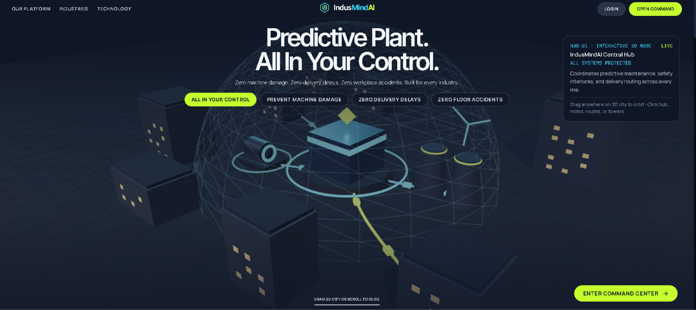
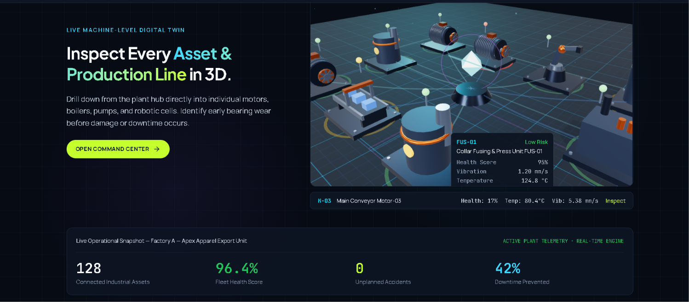
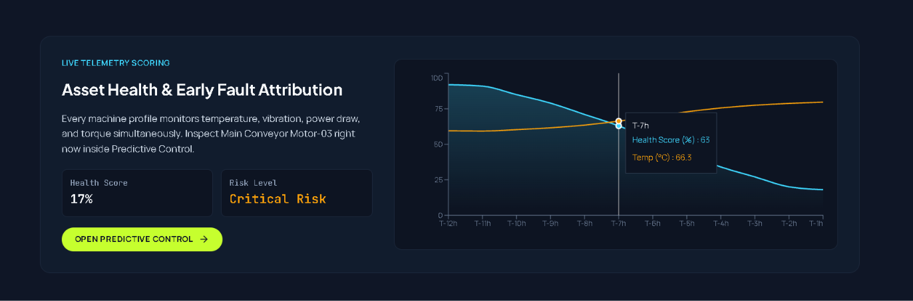
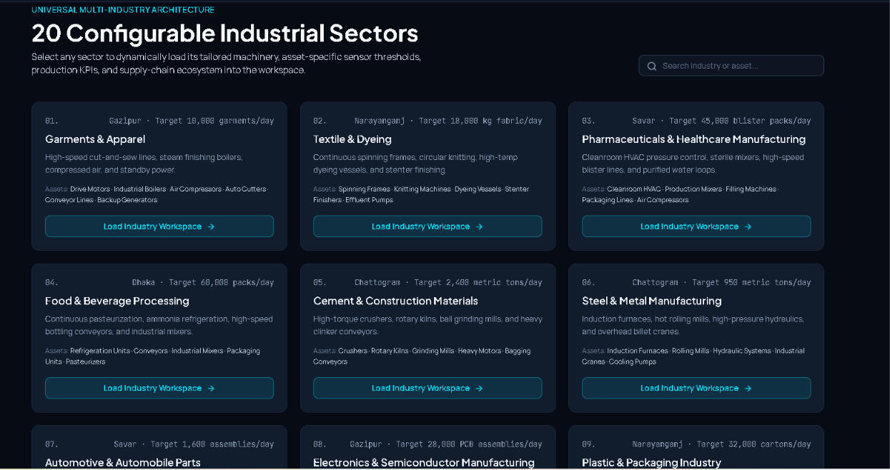
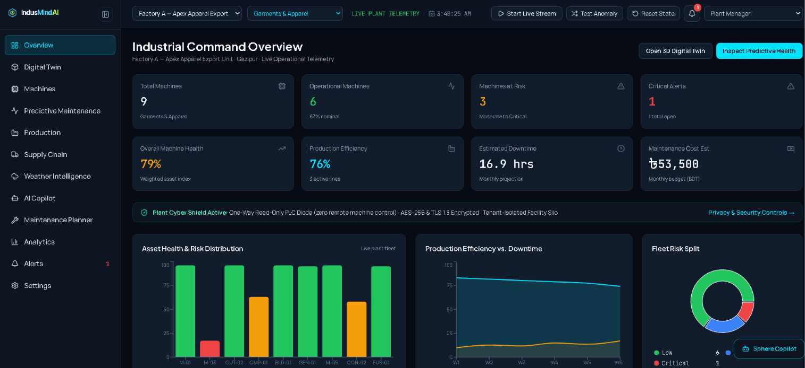
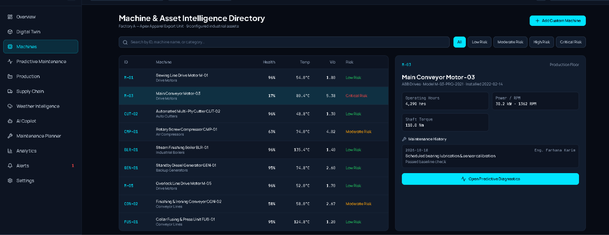
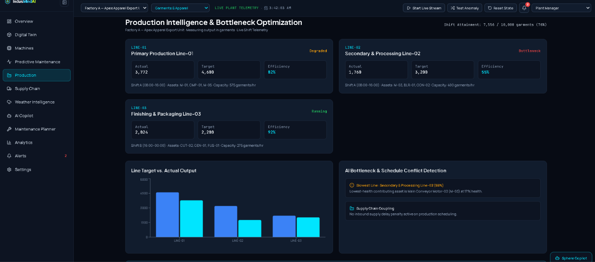
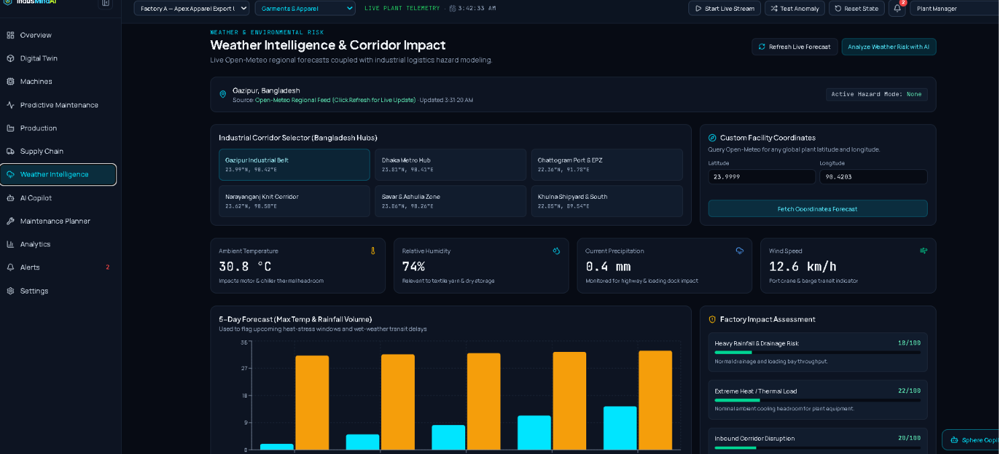
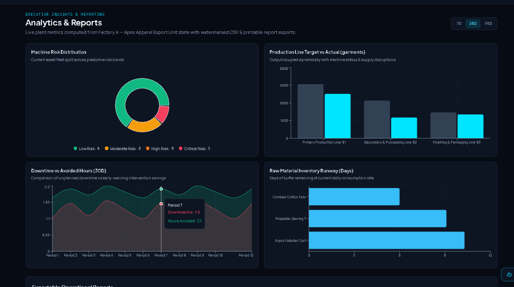
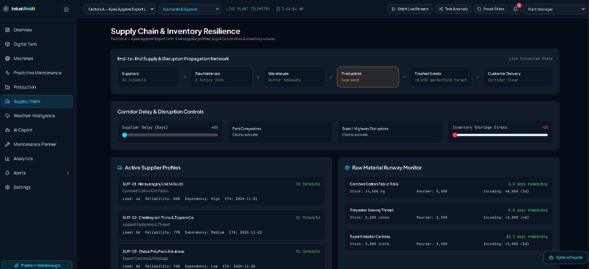

<div align="center">

# IndusMindAI

### Predictive Plant Intelligence · Interactive 3D Digital Twin · Zero-Trust Industrial Control

**Predict Today. Prevent Tomorrow. Produce Smarter.**

<br />

<a href="https://indusmindbd.vercel.app/" target="_blank" rel="noopener noreferrer">
  
</a>

<br />

[](https://indusmindbd.vercel.app/)
[](https://indusmindbd.vercel.app/)
[](https://indusmindbd.vercel.app/)
[](./LICENSE)

</div>

---

## Why I Built IndusMindAI

Across Bangladesh and fast-growing manufacturing hubs globally, factories still run mostly in **reactive mode**. Plant managers and engineers usually find out about a failing drive motor, overheating boiler, or logistics disruption *after* the production line stops, a worker gets injured, or an export shipment misses its vessel cut-off.

I designed and built **IndusMindAI** to give factory owners, plant managers, and maintenance engineers one unified, visual, and predictive command center—so every critical machine, production line, supply corridor, and weather hazard stays **under control before damage happens**.

---

## Real-World Industrial Problems & How IndusMindAI Solves Them

| Industrial Problem | What Usually Goes Wrong | How IndusMindAI Solves It |
| :--- | :--- | :--- |
| **Unplanned Machine Breakdowns** | Motors, boilers, compressors, and conveyors silently develop bearing wear, high vibration, or thermal drift until they seize mid-shift. | Continuously scores **temperature, vibration, power draw, shaft torque, RPM, and operating hours** to catch early fault signatures and alert teams hours or days before failure. |
| **Workplace Floor Accidents** | Overheating equipment, torque spikes, and unmonitored high-pressure boilers create severe safety risks for floor operators. | Real-time safety interlock monitoring escalates abnormal thermal/vibration thresholds to **High / Critical Risk** alerts so crews can lock out and inspect unsafe assets early. |
| **Hidden Production Bottlenecks** | One degraded machine silently slows down an entire line, leaving shift supervisors guessing why daily output targets are missed. | Automatically couples individual machine health scores to **line-level throughput & efficiency**, highlighting exact bottleneck lines and the specific asset causing the drag. |
| **Supply Chain & Delivery Delays** | Supplier delays, Chattogram port congestion, highway disruptions, or low raw-material stock trigger last-minute shipment penalties. | Tracks active supplier ETAs, corridor stress, and **raw material runway (days remaining)**—showing how inbound delays cascade into finished-goods delivery. |
| **Weather & Climate Disruptions** | Monsoon downpours, flooding, and high ambient heat reduce motor cooling headroom and stall factory loading docks. | Integrates **live Open-Meteo regional forecasts** across Bangladesh industrial belts (Gazipur, Dhaka, Chattogram, Narayanganj, Savar, Khulna) or custom plant coordinates to score drainage, thermal, and transit risk. |
| **Cyber Sabotage & Data Leak Fears** | Factory owners worry that putting plant telemetry online could let attackers hijack machinery or steal proprietary production metrics. | Built around a **Zero-Trust Plant Cyber Shield**: one-way read-only PLC diode architecture (zero remote write/actuation), AES-256 & TLS 1.3 transport, and tenant-isolated facility silos. |
| **One-Size-Fits-All Software & High Costs** | Generic tools show identical dummy numbers across sectors and estimate maintenance in unrealistic Western USD budgets. | Supports **20 distinct industrial sectors** with tailored machinery, sensor thresholds, KPIs, and realistic **Bangladeshi Taka (`৳`)** monthly maintenance budgets. |

---

## How Monitoring, Prediction & Early Warning Work

IndusMindAI turns raw plant telemetry into early preventive action through a continuous 4-stage pipeline:

```text
┌──────────────────────────────────┐
│  1. LIVE TELEMETRY & FEED SYNC   │
│  Temp (°C) · Vibration (mm/s)    │
│  Torque (Nm) · Power (kW) · RPM  │
│  Open-Meteo Weather · Suppliers  │
└────────────────┬─────────────────┘
                 ▼
┌──────────────────────────────────┐
│  2. PREDICTIVE HEALTH SCORING    │
│  Weighted asset health (0–100%)  │
│  Early fault attribution & drift │
│  Band: Low → Moderate → Critical │
└────────────────┬─────────────────┘
                 ▼
┌──────────────────────────────────┐
│  3. IMPACT & RUL PROJECTION      │
│  Remaining Useful Life (hours)   │
│  Line bottleneck & shift loss    │
│  BDT (৳) repair budget estimate  │
└────────────────┬─────────────────┘
                 ▼
┌──────────────────────────────────┐
│  4. EARLY WARNING & COPILOT      │
│  Instant critical alert triggers │
│  3D Digital Twin thermal focus   │
│  Maintenance scheduling + Gemini │
│  Copilot action plan (EN / BN)   │
└──────────────────────────────────┘
```

1. **Continuous Multi-Sensor Ingestion:** Every configured machine reports temperature, vibration, shaft torque, power draw, RPM, and cumulative operating hours alongside live regional weather and supply corridor states.
2. **Early Fault Attribution:** Instead of waiting for a hard shutdown, the predictive engine compares current sensor drift against each machine's baseline tolerance curve to calculate a live **Health Score** and **Risk Level**.
3. **Cross-System Coupling:** When an asset's health drops (for example, `M-03` overheating or vibrating above threshold), IndusMindAI immediately calculates the downstream impact on its assigned production line, projected monthly downtime hours, and estimated **BDT (`৳`)** maintenance cost.
4. **Proactive Warnings & Actionable AI:** Operators see visual risk cues directly inside the **3D Digital Twin**, receive prioritized critical alerts, schedule preventive maintenance before failure, and ask **Sphere Copilot** in **English or Banglish** (e.g., *"Kon machine kharap hoye jete pare?"* or *"How do we prevent delivery delays today?"*) to get instant, telemetry-grounded recovery steps.

---

## Platform Walkthrough & Screenshots

### 1. Interactive 3D Command Sphere (Landing Experience)
An immersive Three.js 3D industrial command environment where users can orbit the facility hub, inspect protected systems, and enter the command center directly.



---

### 2. Live Machine-Level 3D Digital Twin
Drill down from the plant hub straight into individual motors, boilers, compressors, robotic cells, and cooling towers with real-time hover inspection and risk-color telemetry overlays.



---

### 3. Asset Health & Early Fault Attribution
Time-series correlation curves track degrading health alongside rising thermal/vibration metrics—pinpointing critical-risk assets hours before breakdown.



---

### 4. 20 Configurable Industrial Sectors
Switch seamlessly across 20 industrial verticals—including Garments & Apparel, Textile & Dyeing, Pharmaceuticals, Food & Beverage, Cement, Steel, Automotive, Electronics, Power Plants, and Water Treatment—each loading its own machinery, KPIs, and cost profiles.



---

### 5. Industrial Command Overview & Plant Cyber Shield
Unified executive overview displaying operational asset counts, weighted fleet health, production efficiency, projected downtime, BDT (`৳`) maintenance budget impact, and active **Plant Cyber Shield** protections.



---

### 6. Machine & Asset Intelligence Directory
Searchable, risk-filterable asset registry with live temperature, vibration, operating hours, shaft torque, and historical technician maintenance logs.



---

### 7. Production Intelligence & Bottleneck Optimization
Shift attainment tracking by production line with automatic **AI Bottleneck & Schedule Conflict Detection** that links slow lines directly to underperforming machines or supply delays.



---

### 8. Weather Intelligence & Corridor Impact
Live Open-Meteo forecasts for major Bangladesh industrial corridors (Gazipur, Dhaka, Chattogram, Narayanganj, Savar, Khulna) plus custom GPS coordinate lookup, paired with drainage, heat-load, and inbound transit risk scores.



---

### 9. Executive Analytics & Reports
Fleet risk distribution, line target vs. actual output, avoided downtime savings, raw material runway charts, and exportable operational reports.



---

### 10. Supply Chain & Inventory Resilience
End-to-end disruption propagation map, interactive supplier/port/highway delay stress controls, active vendor ETAs, and raw material runway alerts.



---

## Architecture & Security Highlights

- **Frontend:** React 19, TypeScript, Vite, Tailwind CSS, Three.js (3D Digital Twin & Command Sphere), Recharts, Lucide Icons, Motion
- **AI & Live Feeds:** Google Gemini (`@google/genai`) server-side API for **Sphere Copilot** + Open-Meteo Live Forecast API
- **Cloud Hosting:** Deployed on Vercel with serverless `/api/*` endpoints (`api/copilot/analyze.ts`, `api/weather.ts`) and `GEMINI_API_KEY` stored securely in cloud environment variables
- **Zero-Trust Industrial Security:**
  - **One-Way Read-Only PLC Diode:** Telemetry ingestion is strictly read-only—no external dashboard action can alter physical machine PLCs or actuators.
  - **Encrypted Transport & Tenant Isolation:** TLS 1.3 in transit, AES-256 at rest, and facility-level data silos.
  - **Server-Side API Key Protection:** Gemini API credentials never leave the server environment.

---

<div align="center">

### Experience the Live Platform

<a href="https://indusmindbd.vercel.app/" target="_blank" rel="noopener noreferrer">
  
</a>

</div>

---

## License

This project is open-source and licensed under the **MIT License** — see the [`LICENSE`](./LICENSE) file for full details.

<div align="center">
  <sub>Developed by <strong>Sarowar Suman</strong> · IndusMindAI</sub>
</div>
